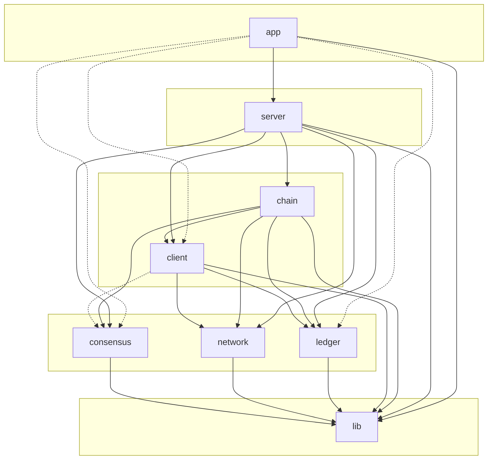

# Folder dependency graph

This document describes how the main source folders in **pp-ledger** depend on each other (build and `#include` dependencies). The diagram omits test subfolders; see **Tests** below.

For integration with **pp-cpp-common**, **pp-browser**, and **pp-node**, see [`platform-integration.md`](PLATFORM_INTEGRATION.md).

## Diagram (Mermaid)

- **Solid arrows**: direct CMake `target_link_libraries` dependency (and typical `#include` use).
- **Dashed arrows**: include-only dependency (e.g. `app` and `client` use consensus types via headers; `client` does not link `pp_consensus` in CMake).

**Notes**

- **`chain`** is the `pp_chain` static library: `Chain`, `AccountBuffer`, and transaction helper modules (`ChainTx*`). Its data types (`Types.h`: chain config, genesis meta, beacon certificate, recovery announcement) are `pp_chain_types`, which links only `lib` and `ledger` — no network code.
- **`operation`** is `pp_operation`: operation files ([OPERATION_FILE.md](../contracts/OPERATION_FILE.md)). It links `pp_chain_types`, `ledger` and `lib` only, so an offline signer needs no network code. Account state types (`UserAccount`, `Wallet`, `MinerState`) live in `ledger` (`Account.h`) for the same reason; `Client` keeps aliases.
- **`server`** still links `lib`, `ledger`, `client`, `consensus`, and `network` directly because Beacon / Miner / Relay code includes those headers for AMP and consensus types, in addition to linking **`pp_chain`** for chain state and validation.

## Tests

| Location | Linked targets | Purpose |
|----------|----------------|---------|
| `src/chain/test/` | `pp_chain`, gtest | `test_chain`, `test_account_buffer` |
| `src/operation/test/` | `pp_operation`, gtest | `test_operation` (links no network code) |

Other component tests remain under their folders (e.g. `src/lib/common/test`, `src/ledger/test`, `src/network/test`).

## Layer summary

| Layer | Folders | Depends on |
|-------|---------|------------|
| **1 – Base** | `lib` | — |
| **2 – Core** | `consensus`, `network`, `ledger` | `lib` |
| **3 – Client API** | `client` | `lib` + core; also uses `consensus` (types, no link) |
| **4 – Chain domain** | `chain` | `lib`, `ledger`, `client`, `consensus`, `network` |
| **5 – Servers** | `server` | `chain` and the same core/client stack as before (direct links plus `pp_chain`) |
| **6 – Entrypoints** | `app` | `lib`, `server`; some executables also use `client`, `ledger`, `consensus` as needed |

## Per-folder dependencies

| Folder | Depends on | Notes |
|--------|------------|--------|
| **lib** | — | Logger, Module, Service, ResultOrError, Serialize, BinaryPack shims; Utilities (ML-DSA via pp-cpp-crypto); Value/Meta/JSON via pp-cpp-common |
| **consensus** | lib | SlotCommittee, EpochManager, SlotTimer, SlotLeaderSelection |
| **network** | lib | AMP ledger RPC: LedgerAmpRuntime, AmpLedgerServer, ServerAmpSupport, NetworkTuning |
| **ledger** | lib | Ledger, DirStore, FileStore, FileDirStore, VolumeStore |
| **client** | lib, ledger, network | Client; also includes `consensus/Types.hpp` (no `pp_consensus` link in CMake) |
| **chain** | lib, ledger, client, consensus, network | `pp_chain`: Chain, AccountBuffer, `Tx*`, handler interface; `pp_chain_types` (Types) links lib and ledger only |
| **operation** | lib, ledger, chain (`pp_chain_types` only) | `pp_operation`: operation files — build, read, sign, merge, summarize |
| **server** | lib, ledger, client, consensus, network, **chain** | Beacon, Miner, Relay, `Server*` facades (Chain comes from `pp_chain`) |
| **app** | lib, server | `pp-beacon`, `pp-relay`, `pp-miner` link `pp_server`; `pp-client` links `pp_client`, `pp_ledger`, `pp_operation` |

## Root CMake order

The root `CMakeLists.txt` adds `src/`, and `src/CMakeLists.txt` adds subdirectories in dependency order:

1. `src/lib`
2. `src/consensus`
3. `src/network`
4. `src/client`
5. `src/ledger`
6. **`src/chain`**
7. `src/operation`
8. `src/server`
9. `src/app`

This order respects the folder dependency graph above (`chain` before `server`).
