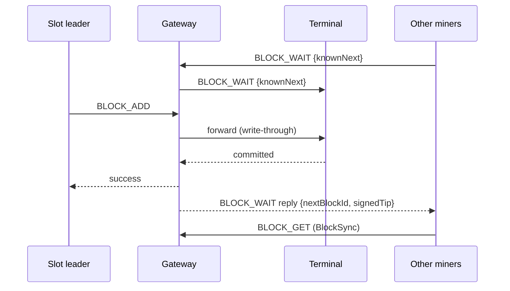

# Ledger network topology

How the beacon, relays and miners interact over the fleet ledger RPC (AMP). Wire format and config
field names: [AMP_TRANSPORT.md](../contracts/AMP_TRANSPORT.md). Roles and consensus:
[DESIGN.md](../product/DESIGN.md). Planned improvements (reorg repair, upstream cross-checks,
range sync, …): [projects/ledger-topology](../../projects/ledger-topology/DESIGN.md).

---

## Roles

| Term | Meaning |
|------|---------|
| **Terminal beacon** | The only node that commits canonical chain state; holds the pending transaction pool and the miner registry. Usually on a private network. |
| **Gateway** | A node that serves the ledger RPC downstream and forwards toward the terminal — today `pp-relay`. Gateways may chain. They are not an authority. |
| **Participant** | Miner or client that consumes upstream endpoints, with the same RPC whether the upstream is a gateway or the terminal. |
| **Opaque upstream** | A configured multiaddr (miner `beacons[]`, relay `beacon`) with no role metadata: "an upstream ledger endpoint". |
| **Realization** | A mutation is realized when the terminal has accepted it into authoritative state. |
| **Write-through** | A gateway reports success on a mutation only after its upstream path reported success. |

```text
┌─────────────────────────────────────────────────────────────┐
│  Participants (miners, clients)                              │
│  — opaque upstream[]; validate the chain locally             │
└───────────────────────────┬─────────────────────────────────┘
                            │  same RPC at every hop
┌───────────────────────────▼─────────────────────────────────┐
│  Gateways (relays) — forward; may chain; never an authority  │
└───────────────────────────┬─────────────────────────────────┘
                            │  write-through for mutations
┌───────────────────────────▼─────────────────────────────────┐
│  Terminal beacon — sole writer of the canonical chain        │
└─────────────────────────────────────────────────────────────┘
```

No hop inspects whether the next one is the terminal; only the last hop of a successful write
realizes it. Gateways dial toward the terminal; participants dial gateways; the terminal needs no
public listen address.

---

## Principles and invariants

| ID | Invariant |
|----|-----------|
| **I1** | Only the terminal beacon commits canonical chain state. |
| **I2** | A gateway returns success on a mutation only if the terminal accepted it on the forwarding path. |
| **I3** | Every node validates every block and transaction before applying it (relays: the whole chain from genesis, same `Chain` code as the beacon). |
| **I4** | A participant may pin network identity (`networkAnchor`); a mismatching upstream is rejected. |
| **I5** | Slot time comes from the terminal's clock (calibrated offset), not the local wall clock. |
| **I6** | The miner registry is terminal-owned; gateways forward registration. |

Design rules behind them: one RPC surface with no role-specific forks; a single writer (no
split-brain commits); local verification at every node; participants configure endpoints, not
roles; fail safe on ambiguity (wrong network → reject the upstream).

The beacon is authenticated end to end, through any number of relays: a node commits a block only
below a tip the beacon signed, with a key the admin-signed trail from genesis certifies
([BEACON_AUTHORITY.md](../contracts/BEACON_AUTHORITY.md)). Pinned Amp peer ids authenticate one hop,
as a convenience. Promotion after a loss is in design:
[projects/beacon-authority](../../projects/beacon-authority/DESIGN.md) (part 2).

---

## Realization contract

| RPC | Answered by | Success means | Gateway rule |
|-----|-------------|---------------|--------------|
| `REGISTER` | Terminal | Miner is in the registry | Write-through |
| `CALIBRATION` | Terminal; a gateway answers with its own clock + offset to its upstream | Terminal time | Mirror the calibrated clock |
| `STATUS` | Any node | Its own head, checkpoint, epoch; `networkId`, `headHash`, `registryVersion`, the beacon's `signedTip`, the current beacon `certificate`, any `equivocation` evidence, a pending `recovery` | Serve local state; the signed tip as heard from upstream; the highest certificate seen ([BEACON_AUTHORITY.md § Certificates out of band](../contracts/BEACON_AUTHORITY.md#certificates-out-of-band)); the evidence the node halts on ([§ Equivocation halt](../contracts/BEACON_AUTHORITY.md#equivocation-halt)); the recovery pending on its chain ([§ Recovery](../contracts/BEACON_AUTHORITY.md#recovery--t_recovery-record-19)) |
| `MINER_LIST` | Terminal registry | Ids at `registryVersion` | Forward |
| `BLOCK_GET` | Any node | Block from local storage | Serve locally |
| `AUTHORITY_PROOF` | Terminal or gateway (chain held from genesis) | The authority-changing records up to a block ([BEACON_AUTHORITY.md § Authority proof](../contracts/BEACON_AUTHORITY.md#authority-proof)) | Serve locally |
| `BLOCK_ADD` | Terminal | Block committed; the reply carries the beacon's signed tip covering it | Write-through; store locally only after the terminal accepts; pass the reply on unchanged |
| `BLOCK_WAIT` | Gateway or terminal | Reply carries the answerer's `nextBlockId` and the latest signed tip it holds | Serve from own tip |
| `TX_ADD` | Terminal pool | Tx held for a slot leader | Write-through; a beacon certificate is also kept by every node it passes |
| `TX_PULL` | Terminal pool | Pending txs for the leader | Pass through |
| `EQUIVOCATION_ADD` | Every node on the way up | Evidence kept; the node halts on it | Keep, then write-through |
| `ACCOUNT_GET`, `TX_*` | Any node | State at its own tip | Serve locally |

### Request direction

Each node knows its upstreams by peer id (the `/p2p/<PeerId>` of its configured multiaddrs), and
AMP authenticates every request's sender. `Server::isAllowedFrom` applies one table for all roles
before any handler runs:

| Request | From downstream | From own upstream |
|---------|-----------------|-------------------|
| `BLOCK_ADD`, `REGISTER`, `TX_ADD` (writes travelling up) | Accepted | **Refused** |
| `BLOCK_WAIT` (blocks travel down) | Accepted | **Refused** |
| `MINER_LIST`, `TX_PULL` (registry and pool live upstream) | Accepted | **Refused** |
| Everything else | Accepted | Accepted |

Miners do not accept `BLOCK_ADD` at all: they learn blocks by syncing from their upstream.

`allowedPeers` (optional, any role) admits only listed peer ids and the node's upstreams
(`Server::isAllowedPeer`, checked before queueing) — e.g. a beacon reachable only by its relays.

Each request also gets a priority lane (`Server::laneFor`): reads such as `BLOCK_GET`,
`BLOCK_WAIT` and account / history queries go to a low-priority lane with its own capacity and a
per-peer cap, so serving downstream sync never blocks a node's own work
([THREADING.md](THREADING.md)).

---

## Network anchor

A participant may pin network identity independently of its upstream multiaddrs:

```json
"networkAnchor": { "networkId": "pp-mainnet-1", "genesisHash": "<hex>", "trustedCheckpointId": 42 }
```

At startup a miner fetches `STATUS` from each upstream and rejects one whose `networkId` differs
or whose checkpoint is below `trustedCheckpointId`; when it connects it checks the genesis hash
(`NetworkAnchor.h`).

---

## Chain sync

| Mode | When | Behavior |
|------|------|----------|
| **Cold start** | New node | Anchor check → mount (miner: from the upstream's checkpoint, checked against `AUTHORITY_PROOF` when genesis is pinned; relay: from genesis) → sync to head. A miner warms up until the next checkpoint and seals once its history covers the transaction validity window ([BLOCK_PIPELINE.md § Checkpoints and late join](BLOCK_PIPELINE.md#checkpoints-and-late-join)) |
| **Catch-up** | Behind | `BlockSync` takes the upstream's beacon signed tip from `STATUS`, fetches the gap up to it with up to 4 `BLOCK_GET`s in flight, checks the hash chain up to the signed hash, then applies in order ([BEACON_AUTHORITY.md § Adoption rule](../contracts/BEACON_AUTHORITY.md#adoption-rule)) |
| **Tip follow** | Near head | One `BLOCK_WAIT` held open to the upstream; its reply triggers a sync |

A block that does not extend the local tip, a chain that does not lead to the signed hash, or a tip
that does not verify fails the sync, which backs off (0.5 s → 8 s); a miner then rotates to its next
upstream. Nothing above the signed tip is committed.

**Several upstreams (miners).** At startup a miner fetches `STATUS` from each `beacons[]` entry,
drops any failing the anchor, and syncs from the one whose signed tip has the highest beacon
generation, then the highest `nextBlockId`. It
broadcasts its own blocks (`BLOCK_ADD`) to every upstream at once and commits one only when a reply
carries the beacon's verified signed tip for it. Sync, `TX_*`, registration and calibration use the
active upstream only.

**Gateways** sync from their single configured upstream (the relay's `beacon`), never from
downstream miners.

**Checkpoints:** every node rotates checkpoints deterministically; a miner joins from a
checkpoint and replays only later blocks ([BLOCK_PIPELINE.md](BLOCK_PIPELINE.md)).

---

## Miner coordination

### Block propagation — up to commit, down by waiting

| Path | Purpose |
|------|---------|
| **Leader → terminal** (`BLOCK_ADD`, up only) | Canonical commit — the only realization path |
| **Upstream → downstream** (`BLOCK_WAIT`, down only) | Fast propagation to gateways and miners |
| **Participant → upstream sync** | Safety net for anything a wait missed |



### BLOCK_WAIT

- Each relay and miner keeps one `BLOCK_WAIT {knownNextBlockId}` open to its upstream
  (`UpstreamTipWatch`). The upstream replies with its `nextBlockId` (and the beacon's latest
  signed tip it holds — [BEACON_AUTHORITY.md § Signed tip](../contracts/BEACON_AUTHORITY.md#signed-tip)) as
  soon as that passes `knownNextBlockId`, or unchanged after a hold of T/2; the downstream then
  re-arms.
- When the reply shows the upstream ahead, the downstream syncs and applies blocks only after full
  validation (I3).
- **Downward only, once per block:** only an upstream answers a wait, and the next wait starts from
  the `nextBlockId` already reported — no list of downstreams, no dialing toward them
  (NAT-friendly).
- Cheap to misuse: one wait per peer is held (a newer one answers the older); waits sit in the
  low-priority lane; a reply only triggers a rate-limited sync from the node's own upstream.
- Miners do not serve `BLOCK_WAIT`. An upstream that does not serve it makes the watch back off
  (1 s → 30 s); sync keeps the node current.

### Transactions — up to the terminal pool, pulled by the leader

| Step | Actor | Action |
|------|-------|--------|
| 1 | Client | `TX_ADD` to a relay or the terminal (pp-client `-b`, pp-http) |
| 2 | Relay / miner | Pass `TX_ADD` up (write-through); never to another miner |
| 3 | Terminal | Hold it in `TxPool` (bounded, deduplicated, expires with the tx's validity window or after 10 min) |
| 4 | Slot leader | `TX_PULL {slot}` through its upstream at the slot's start; waits up to min(1 s, slot/3) |
| 5 | Leader | Pool what applies; include it; `BLOCK_ADD` up to the terminal |
| 6 | Terminal | Drop the block's records from the pool |

A transaction never goes miner → miner. The terminal drops one only once a committed block
includes it (or it expires), so one a leader missed reaches the next leader.

**Leader pool.** A leader validates every transaction it pools against its buffer for the current
slot, rebuilt from the tip whenever the tip moves; a block draft holds each idempotency key once.
Pending transactions that no longer apply are dropped rather than aborting the slot. A rejection by
the leader's pool is final; out-of-order dependent transactions must be resubmitted.

### Registration

- `REGISTER` records are signed by the miner account's keys (on-chain `publicKeys` /
  `minSignatures`); the terminal refuses an `issuedAt` more than 5 min from its clock or not newer
  than the recorded one. Gateways pass records on unchanged.
- The terminal keeps `{ miner_id, last renewal }` (no address) and a `registryVersion`, which
  changes only when the list does. Miners renew every 60 s; a record not renewed within 5 min is
  dropped (`MinerRegistry`). A miner starts even when its first registration is refused (a beacon
  that stood down refuses them, [BEACON_AUTHORITY.md § Rewind](../contracts/BEACON_AUTHORITY.md#rewind))
  and keeps renewing.
- **No published miner addresses:** registrations carry none, `MINER_LIST` returns ids only, and
  transactions reach the leader by `TX_PULL`. Miners dial out to relays, so the public leader
  schedule cannot be used to flood the next leader.
- Leader election uses on-chain miner registration (`T_MINER_REGISTER`), not this registry
  ([WIRE_SCHEMA.md](../contracts/WIRE_SCHEMA.md#miner-registration-and-liveness)).

---

## Time and slots

`CALIBRATION` returns the terminal's time. Relays and miners calibrate once at startup to their
upstream: up to 5 samples, the lowest-RTT one wins (or the first if its RTT ≤ 200 ms), applied as a
whole-second offset. A relay answers `CALIBRATION` with its own clock plus that offset. Slot,
epoch, the seal window and the delivery deadline all use the calibrated clock.

---

## Security model

| Threat | Mitigation today |
|--------|------------------|
| Invalid blocks / transactions | Rejected locally at every node (I3) |
| Wrong network | `networkAnchor` (network id, genesis hash, trusted checkpoint) |
| Fake registration | Signed `REGISTER`, verified by the terminal |
| Flooding | Per-peer lanes and caps; `allowedPeers`; AMP link limits |
| Targeted flooding of the next leader | Miner addresses not published |
| Fake beacon behind a relay | Blocks commit only below a verified signed tip ([BEACON_AUTHORITY.md § Adoption rule](../contracts/BEACON_AUTHORITY.md#adoption-rule)); a relay can withhold or serve stale data, not forge |
| Stolen beacon key | Admins certify a new generation with a cutover, enforced out of band; two tips at one height halt the network ([§ Certificates out of band](../contracts/BEACON_AUTHORITY.md#certificates-out-of-band), [§ Equivocation halt](../contracts/BEACON_AUTHORITY.md#equivocation-halt)); taking over is part 2 |
| Stolen admin keys | The recovery set replaces them after a visible delay ([§ Recovery](../contracts/BEACON_AUTHORITY.md#recovery--t_recovery-record-19)) |

**Ops-only controls** (invisible on the wire): the terminal allowlists its relays (`allowedPeers`);
relays limit connections and payload sizes; a private terminal has no public multiaddr.

---

## Reliability

| Operation | Idempotent? | Note |
|-----------|-------------|------|
| `BLOCK_ADD` (same hash) | Yes | A node already holding the block (same id and hash) answers success without validating or forwarding again; a different block at that id is refused (`BlockAddPolicy.h`) |
| `REGISTER` | Yes | Upsert |
| `TX_ADD` | Yes | The pool holds one copy per record; the chain refuses a repeated idempotent id |

| Failure | Behavior today |
|---------|----------------|
| Miner's upstream down | Rotates to the next `beacons[]` entry |
| Relay's beacon down | Writes fail; the relay keeps serving its own chain |
| Terminal unavailable | Writes fail |
| Block that does not extend the tip | Sync fails and backs off; there is no reorg repair |
| Missed slot | Empty slot; the chain continues |

---

## Non-goals

- Exposing relay vs terminal role on the wire or in participant config.
- DHT or open peer discovery for fleet nodes (curated multiaddrs instead).
- Gateways committing canonical state.
- Trusting upstream IP or DNS instead of chain anchors and hashes.
